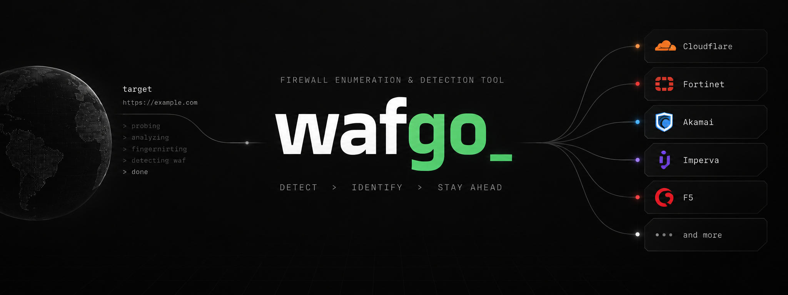

<p align="center">
  
</p>

<h1 align="center">wafgo</h1>

<p align="center"><b>Fast Web Application Firewall fingerprinting.</b></p>

<p align="center">
  
  
  
</p>

wafgo tells you which WAF or CDN sits in front of a site, whether it is
**actively blocking** or just **fronting** the origin, where the **origin IPs**
might be, and which **bypasses** are known — as one static binary that scans
many targets concurrently.

> ⚠️ **Authorized use only.** Scan systems you own or have explicit permission to test.

## Install

```bash
go install github.com/miglen/wafgo/cmd/wafgo@latest   # Go
docker run --rm miglen/wafgo https://example.com      # Docker (multi-arch)
```

## Usage

```bash
wafgo https://example.com                 # fingerprint one site
wafgo -a -i targets.txt -f json           # many targets, every match, JSON
wafgo -O -X https://example.com           # + origin IPs + known bypasses
wafgo -l                                  # list detectable WAFs
```

```
[+] The site https://example.com is behind Cloudflare (Cloudflare Inc.) WAF.
    ↳ actively filtering — attack probe returned a block (HTTP 403 vs normal 200)
```

Full flags in [docs/USAGE.md](docs/USAGE.md); design in [docs/ARCHITECTURE.md](docs/ARCHITECTURE.md).

## How it compares

|                              | **wafgo** | wafw00f | WhatWaf | nuclei `waf-detect` | cloudbunny |
|------------------------------|:---------:|:-------:|:-------:|:-------------------:|:----------:|
| WAF/CDN signatures           | **264**   | 172     | 89      | ~92                 | –          |
| Concurrent multi-target      | ✅        | ❌      | partial | ✅                  | n/a        |
| CDN vs. *enforcing* WAF      | ✅        | ❌      | ❌      | ❌                  | ❌         |
| Behavioural (generic) detect | ✅        | ✅      | ✅      | ❌                  | ❌         |
| Origin-IP discovery          | ✅        | ❌      | ❌      | ❌                  | ✅         |
| Active bypass fuzzer         | ✅ (11)   | ❌      | ✅ (36) | ❌                  | ❌         |
| JSON / CSV output            | ✅        | ✅      | ✅      | ✅                  | ❌         |
| Single static binary         | ✅        | ❌      | ❌      | ✅                  | ❌         |
| Go library API               | ✅        | ❌      | ❌      | ✅                  | ❌         |

**Where the others go further:** nuclei is a general-purpose scanner (thousands
of templates beyond WAFs); WhatWaf ships a larger tamper-script library (36 vs.
our 11) and an arbitrary-payload encoder; cloudbunny adds ZoomEye as an origin
source. wafgo is WAF-focused and folds the most useful parts of each into one
fast tool.

## Benchmark

Scanning the **same 123 live hosts**, single run, same machine:

| Tool | Time | Detected | Notes |
|------|-----:|:--------:|-------|
| **wafgo `-c 50`** | **7.2 s** | 121 | concurrent |
| **wafgo `-c 10`** (default) | **14.7 s** | 121 | concurrent |
| nuclei `waf-detect` | 10.4 s | 86 | 1 request/host, fewer signatures |
| wafw00f | 223.9 s | 116 | sequential — **~15–31× slower** |
| WhatWaf `--skip` | did not finish in 13.5 min | – | sequential |

wafgo is **~15–31× faster than wafw00f** and finishes where WhatWaf does not,
while doing *more* per host than nuclei (two probes, 264 signatures, the
CDN-vs-WAF verdict, and generic fallback). Agreement with wafw00f on whether a
host has a WAF is **95.8%**; on the specific product wafgo matches or is *more
specific* on ~98% of hosts (it names the WAF where wafw00f reports "Generic").
Live, network-bound numbers — expect a few seconds of variance.

## Library

```go
eng, _ := wafgo.New(wafgo.Options{FindAll: true})
rep, err := eng.Scan(context.Background(), "https://example.com")
if err == nil {
	for _, w := range rep.WAFs {
		fmt.Printf("%s — %s\n", w.Name, rep.Enforcement)
	}
}
```

## References

wafgo stands on prior work and reuses or cites, under their licenses:
[wafw00f](https://github.com/EnableSecurity/wafw00f) (signatures & detection
logic), [nuclei-templates](https://github.com/projectdiscovery/nuclei-templates)
(`waf-detect` signatures), [WhatWaf](https://github.com/Ekultek/WhatWaf) and
[PayloadsAllTheThings](https://github.com/swisskyrepo/PayloadsAllTheThings)
(bypass reference), [cloudbunny](https://github.com/Warflop/cloudbunny) (origin
discovery). Signatures are generated, never hand-edited — see
[docs/ARCHITECTURE.md](docs/ARCHITECTURE.md).

BSD 3-Clause licensed (see [LICENSE](LICENSE)). Trademarks belong to their owners.
